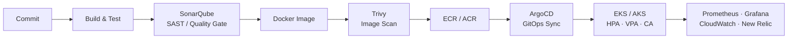

<h1 align="center">Maheswari Krupa</h1>
<p align="center"><b>DevOps Engineer · AWS EKS · Terraform · GitOps · Observability</b></p>
<p align="center"><i>Faster releases, lower cloud spend, fewer 3 AM surprises.</i></p>

<p align="center">
  <a href="https://www.linkedin.com/in/maheswari-krupa/"></a>
  
  
</p>

---

```bash
$ whoami
maheswari-krupa

$ cat profile.yaml
role:       DevOps Engineer @ Tata Consultancy Services (since Jun 2023)
scale:      20+ microservices on AWS EKS, Dev -> QA -> UAT -> Prod
focus:      Kubernetes · Terraform · CI/CD · GitOps · DevSecOps · Observability
cloud:      AWS (primary), Azure
on_call:    24/7 rotation, P1/P2 incident response and RCA
approach:   automate it, secure it, monitor it, document it
```

## 📈 Impact

| Metric | Result | How |
|---|---|---|
| ⚡ Release cycle time | **-40%** | End-to-end Jenkins CI/CD with automated build, test and security scanning |
| 💰 Monthly AWS spend | **~-30%** | Right-sizing EC2/RDS, Reserved Instances, Spot for non-critical workloads |
| 📉 Over-provisioning | **~-25%** | HPA + VPA + Cluster Autoscaler across 20+ microservices |
| 🚦 Deployment downtime (AKS) | **~-25%** | Azure DevOps + Helm with rollback-ready releases |
| 🛠️ Incident resolution (AKS) | **~30% faster** | Azure Monitor + New Relic dashboards and alerting |

## 🧭 How I Ship

Every change follows one path: built, scanned, versioned, deployed through Git, and observed.



## 🛠️ Toolbox

| Domain | Stack |
|---|---|
| **Cloud** |   |
| **Kubernetes** |      |
| **CI/CD & GitOps** |     |
| **IaC** |   |
| **Observability** |     |
| **Security & Quality** |    |
| **Data & Scripting** |     |

## 🚀 Featured Work

### 🔹 Cloud-Native Insurance Platform on AWS EKS
Microservices platform (policy purchase, renewal, claims) running on EKS across Dev, QA, UAT and Prod.
- Terraform modules for VPC, EKS, RDS, S3, IAM, Route53 and ECR, with workspaces and remote state
- Jenkins pipelines with Trivy and SAST gates; ArgoCD GitOps for consistent, auditable deployments
- HPA + VPA + Cluster Autoscaler on 20+ services for SLA adherence during traffic spikes
- DR: RDS point-in-time recovery, cross-region S3 replication, defined RTO/RPO and P1 runbooks
- Security: policy-as-code admission control, Secrets Manager rotation, SOC 2-aligned controls

`EKS` `Terraform` `Jenkins` `ArgoCD` `Prometheus` `Grafana` `CloudWatch` `RDS`

### 🔹 Containerized Platform on Azure AKS
Azure DevOps pipelines that build, push to ACR and deploy to AKS with Helm.
- Terraform for Resource Groups, VNets, Key Vault and Blob Storage
- Rollback-ready Helm releases; ~25% less deployment downtime
- Azure Monitor + New Relic dashboards; ~30% faster incident resolution

`AKS` `ACR` `Azure DevOps` `Helm` `Terraform` `New Relic`

### 🔹 Cost Optimization Program (AWS)
Used Cost Explorer and Trusted Advisor to find waste, then right-sized EC2/RDS, introduced Reserved Instances and moved non-critical workloads to Spot. **~30% lower monthly spend** with no SLA impact.

### 🔹 Operational Automation
Python and Bash tooling for infrastructure health checks and manual-task reduction, plus architecture diagrams and runbooks that on-call engineers actually use.

## 🎯 Currently Sharpening

- Production-grade Kubernetes troubleshooting and upgrade strategy
- Reusable Terraform module design
- DevSecOps depth: policy-as-code, supply-chain scanning
- Observability that drives action: SLO-based alerting

## 🏆 Recognition

Applause Award (Jul 2025, Aug 2026) · Service & Commitment Award (Jun 2026) · On The Spot Award (Jul 2025) · tcsAI Spark and Idea Igniter appreciations: *Tata Consultancy Services*

## 🎓 Education

B.Tech, Mechanical Engineering: Pragati Engineering College (2018-2022), CGPA 8.66

## 📫 Let's Connect

Open to conversations about cloud, Kubernetes and platform engineering.
**[LinkedIn →](https://www.linkedin.com/in/maheswari-krupa/)**

<p align="center"><sub>Reliable infrastructure is built through practice, automation, and continuous learning.</sub></p>
